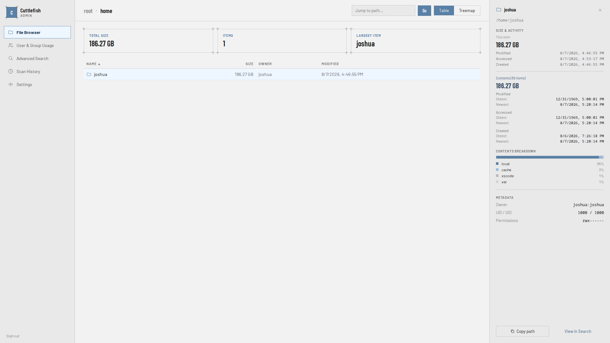

# Cuttlefish

A high-performance filesystem intelligence platform. Indexes billions of inodes into PostgreSQL, computes recursive directory statistics, and exposes everything through a REST API with a React browser UI.



---

## Components

| Component | Language | Role |
|---|---|---|
| `fs_indexer` | Rust | Walks the filesystem in parallel, writes raw metadata to PostgreSQL |
| `fs_aggregator` | Rust | Computes recursive directory and ownership statistics |
| `fs_api` | Go | REST API over the database; serves the compiled UI |
| `fs_ui` | TypeScript / React | Browser frontend |
| `fs_common` | Rust (lib) | Shared config, DB connection, and path hashing used by the Rust binaries |

---

## Installation (RPM)

Pre-built RPMs for Rocky Linux / RHEL / AlmaLinux are attached to each [GitHub Release](../../releases). A single package contains all binaries, the web UI, and all systemd units.

### 1. Install the package

**Rocky Linux / RHEL 9:**
```bash
sudo rpm -i cuttlefish-<version>-1.el9.x86_64.rpm
```

**Rocky Linux / RHEL 10:**
```bash
sudo rpm -i cuttlefish-<version>-1.el10.x86_64.rpm
```

### 2. Configure

```bash
sudo cp /etc/cuttlefish/fs_config.yml.example /etc/cuttlefish/fs_config.yml
sudo $EDITOR /etc/cuttlefish/fs_config.yml
```

At minimum set your PostgreSQL credentials and generate a session secret:

```bash
openssl rand -hex 32   # paste result into session_secret
```

### 3. Enable the API server

```bash
sudo systemctl enable --now cuttlefish-api
# → http://localhost:8080
```

### 4. Schedule nightly indexing

```bash
sudo systemctl enable --now cuttlefish-index.timer
```

This fires `fs_indexer` nightly at 2am. On success it automatically chains to `fs_aggregator`. Check the next scheduled run and last result:

```bash
systemctl status cuttlefish-index.timer
journalctl -u cuttlefish-index.service
journalctl -u cuttlefish-aggregate.service
```

To re-aggregate without re-indexing (e.g. after a config change):

```bash
sudo systemctl start cuttlefish-aggregate.service
```

---

## Systemd units

| Unit | Type | Description |
|---|---|---|
| `cuttlefish-api.service` | Service | REST API server — enable and run permanently |
| `cuttlefish-index.service` | Oneshot | Runs `fs_indexer` as root (scan root/threads from `fs_config.yml`); chains to aggregate on success |
| `cuttlefish-index.timer` | Timer | Triggers the indexer nightly at 2am (`Persistent=true`) |
| `cuttlefish-aggregate.service` | Oneshot | Runs `fs_aggregator` as the `cuttlefish` user |

---

## Configuration

All components read `fs_config.yml` from their working directory (`/etc/cuttlefish` when installed via RPM). The file is **gitignored** — use `fs_config_template.yml` as the starting point.

Any string value can be written as `${VAR}` to read it from an environment variable at startup (an unset variable is an error). If every `password`, `session_secret` and `client_secret` is supplied that way, the file contains no secrets and the 0640 permission requirement is lifted. That suits Kubernetes: the config is a ConfigMap and the secrets come from a Secret via `env`.

```yaml
database:
  host: localhost
  user: postgres
  password: "..."
  dbname: fs_index
  sslmode: verify-full

indexer:
  root_path: /            # a single scan root for fs_indexer
  # root_paths:           # …or several, walked in parallel; must not overlap
  #   - /home
  #   - /srv/data
  threads: 8              # optional, defaults to 8; shared across all roots

auth:
  session_secret: "..."   # openssl rand -hex 32 — must be ≥ 32 chars

  local:                  # single admin account
    username: admin
    password: "..."

  # oidc:                 # uncomment to use SSO instead of local auth
  #   issuer: "https://login.microsoftonline.com/<tenant-id>/v2.0"
  #   client_id: "..."
  #   client_secret: "..."
  #   redirect_url: "https://yourhost/auth/callback"
  #   extra_scopes: ["offline_access"]   # refresh tokens, needed for the IdP re-check
  #   groups_claim: groups               # claim carrying the user's groups (or "roles")
  #   username_claim: preferred_username # identity claim; default email, then sub
  #   admin_groups: ["..."]              # required in OIDC mode
  #   viewer_groups: ["..."]
  #   recheck_interval: 5m
```

The API server rejects a missing, default, or short `session_secret` at startup.

---

## Access control

With SSO, a user's role comes from the groups their IdP puts in the token:

| Role | Who | Can see |
|---|---|---|
| `admin` | any group in `auth.oidc.admin_groups` | everything, plus the **Admin** page |
| `viewer` | any group in `auth.oidc.viewer_groups` | everything |
| restricted | everyone else | only the paths granted on the Admin page; no User & Group Usage |

On the Admin page, an admin grants a group read access to a path prefix (e.g. `eng` → `/srv/eng`). Two special forms:

- Group **`*`** applies to every signed-in user.
- **`{user}`** in a path becomes the user's identity with its `@domain` removed and lowercased. One grant of `*` → `/home/{user}` gives `joshua@corp.com` access to `/home/joshua`. Because the domain is dropped, `joshua@a.com` and `joshua@b.com` map to the same home, so set `allowed_domains` if more than one domain can sign in.

Grant changes apply on the user's next request. Sessions are re-checked with the IdP every `recheck_interval` (default 5 minutes): a user who is disabled, signed out, or moved to another group at the IdP is blocked or re-roled within that interval, with no action in Cuttlefish. If the IdP can't be reached, the check fails and the user is signed out. With local (non-SSO) login, the single local account is always admin.

### Microsoft Entra ID

1. **Register the app.** Entra admin center → *App registrations* → *New registration*. Add a **Web** redirect URI of `https://yourhost/auth/callback`, then create a client secret under *Certificates & secrets*. Copy the *Application (client) ID* and *Directory (tenant) ID*.

2. **Point Cuttlefish at it.**

   ```yaml
   auth:
     oidc:
       issuer: "https://login.microsoftonline.com/<tenant-id>/v2.0"
       client_id: "<application-client-id>"
       client_secret: "<secret-value>"
       redirect_url: "https://yourhost/auth/callback"
       extra_scopes: ["offline_access"]
       username_claim: preferred_username
   ```

   `offline_access` is required: Entra only issues a refresh token when it's requested, and without one every session ends after a single `recheck_interval`.

3. **Pick a username claim.** Entra's v2 ID token always carries `preferred_username`, which is normally the UPN (`joshua@corp.com`), so `username_claim: preferred_username` works with no extra setup. To use the `upn` claim itself, add it under *Token configuration* → *Add optional claim* → *ID* → `upn`, and set `username_claim: upn`. Guest users' UPNs look like `joshua_corp.com#EXT#@tenant.onmicrosoft.com`, so `/home/{user}` grants won't give them sensible paths.

4. **Send roles or groups.** There are two ways to do this.

   - **App roles (recommended).** Under *App roles*, create roles such as `cuttlefish-admin` and `cuttlefish-viewer`, plus one per restricted team. In *Enterprise applications* → your app → *Users and groups*, assign Entra groups to those roles. Then set:

     ```yaml
     groups_claim: roles
     admin_groups: ["cuttlefish-admin"]
     viewer_groups: ["cuttlefish-viewer"]
     ```

     Role values are readable names, and only roles for this app are sent, so the token stays small.

   - **Groups claim.** Under *Token configuration* → *Add groups claim*, choose *Security groups* (or, better, *Groups assigned to the application*). Entra sends **group object IDs (GUIDs), not names**, so `admin_groups`, `viewer_groups` and Admin-page grants must use the GUIDs. Group names are only available for groups synced from on-premises AD (`sAMAccountName`), or, where your tenant offers it, for cloud-only groups assigned to the application. Check *Token configuration* for the options your tenant has. A user in more than 200 groups gets no `groups` claim at all (Entra's "overage" behaviour), which makes them restricted with no paths. *Groups assigned to the application* avoids that.

5. **Domain allowlist.** `allowed_domains` matches the `email` claim, which Entra only sends if the user has a mail attribute and you add `email` as an optional ID-token claim. Otherwise use `allowed_users`, or rely on *Assignment required? = Yes* in the enterprise application's properties, so that only assigned users can sign in at all.

6. **Revoking access.** Disabling the account, running *Revoke sessions* on the user (or `Revoke-MgUserSignInSession`), or removing their role or group assignment takes effect in Cuttlefish at the next re-check.

---

## Building from source

### Prerequisites

- Rust (stable)
- Go 1.26+
- Node.js 22+
- PostgreSQL client libraries

### Build

```bash
# 0640, not a plain cp: the config holds the DB password and session secret, and
# every component refuses to start if it is readable by other users on the host.
install -m 0640 fs_config_template.yml fs_config.yml
$EDITOR fs_config.yml
make all
```

### Run

```bash
cd /path/containing/fs_config.yml
sudo fs_indexer/target/release/fs_indexer         # index filesystem (root_path/threads from fs_config.yml; root required to scan)
fs_aggregator/target/release/fs_aggregator        # compute stats
fs_api/fs_api                                     # start API server → :8080
```

### Build targets

```bash
make all              # build everything
make build-indexer    # Rust release build of fs_indexer
make build-aggregator # Rust release build of fs_aggregator
make build-ui         # Vite production build of fs_ui → copies into fs_api/ui/
make build-api        # Go build of fs_api
make swagger-api      # regenerate Swagger docs then build API
make run-indexer      # build + scan /
make run-aggregator   # build + aggregate
make run-api          # build everything + start server
make clean            # remove all build artifacts and node_modules
```

---

## Database schema

Tables are created automatically on first run.

| Table | Written by | Description |
|---|---|---|
| `filesystem_index` | `fs_indexer` | One row per filesystem entry; primary key is SHA-256(path) |
| `identity_map` | `fs_indexer` | UID/GID → username/groupname |
| `scan_sessions` | `fs_indexer` | Per-run timestamps; used for stale-entry cleanup |
| `dir_stats` | `fs_aggregator` | Recursive size, file count, and time ranges per directory |
| `user_stats` | `fs_aggregator` | Total size and file count per UID/GID |
| `sessions` | `fs_api` | Logged-in sessions (cookie hash, identity, groups, refresh token) |
| `access_grants` | `fs_api` | Group → path-prefix grants managed on the Admin page |

---

## API

Swagger UI is served at `/swagger/` once the server is running; it requires a logged-in session.

| Method | Path | Description |
|---|---|---|
| `GET` | `/api/list?path=` | List directory children |
| `GET` | `/api/file/stats?path=` | Single file metadata |
| `GET` | `/api/dir/stats?path=` | Single directory metadata + aggregates |
| `GET` | `/api/user/list` | User storage totals (sortable, paginated) |
| `GET` | `/api/group/list` | Group storage totals (sortable, paginated) |
| `GET` `POST` `DELETE` | `/api/admin/grants` | Manage path grants (admin only) |
| `POST` | `/auth/login` | Local login |
| `GET` | `/auth/oidc/start` | Begin SSO login flow |
| `POST` | `/auth/logout` | Clear session |
